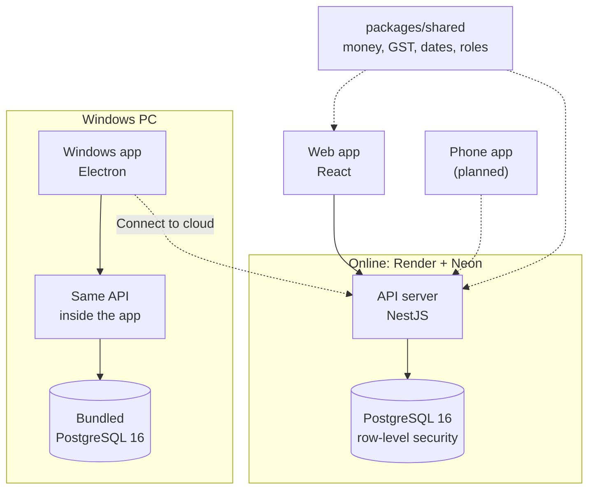

<div align="center">

# Shop Billing App

**GST billing, stock and accounting for Indian shops and small businesses.**

Web · Windows (works offline) · Android and iPhone (coming)

[](https://github.com/amn-kr/billing-erp/actions/workflows/ci.yml)


</div>

> The app's name, as people see it, is set in one place: `packages/shared/src/brand.ts` (how to rename: [`docs/RENAME.md`](docs/RENAME.md)).

## Contents

- [Latest](#latest)
- [Features](#features)
- [Ways to use it](#ways-to-use-it)
- [Technology](#technology)
- [Architecture](#architecture)
- [Project structure](#project-structure)
- [Prerequisites](#prerequisites)
- [Setup and installation](#setup-and-installation)
- [Environment variables](#environment-variables)
- [Database and migrations](#database-and-migrations)
- [Start the server](#start-the-server)
- [Security and CORS](#security-and-cors)
- [Testing](#testing)
- [Deployment, releases and backups](#deployment-releases-and-backups)
- [Progress](#progress)
- [The one hard rule](#the-one-hard-rule)
- [Documentation](#documentation)
- [Copyright](#copyright)

---

## Latest

_Last updated: 21 Nov 2026. Details: [`docs/STATUS.md`](docs/STATUS.md)._

| | |
|---|---|
| **Where we are** | Phases 0 to 4 are done. The Windows app (Phase 6) is built. Real-PC checks are under way: install (Windows 10 and 11), This PC only, printing, restore and update passed (18 Nov 2026). Left: backups, cloud move, connect to cloud and uninstall, then a two-week trial in the owner's shop, after the phone app is launched. Web and Windows now use the **Inter** font, like the phone app (owner, 19 Nov 2026); installed Windows apps get it with the next release. |
| **Latest Windows release** | **v0.1.1** (13 Nov 2026): adds *Bring online books to this PC*. Installers are on the [releases page](https://github.com/amn-kr/billing-erp-releases/releases). |
| **Live web app** | https://billing-erp-ynqf.onrender.com (free plans; the first open after 15 idle minutes can take about a minute). |
| **Needs attention** | Nightly database backups have not run since 9 Nov 2026. The fix is merged (PR #105) and in the backup repository, but GitHub's Actions budget stops every run. On hold until 1 Dec 2026, when the free minutes return; a reminder will run one backup and check the restore test that day. |
| **Latest phone release** | **Android app 1.0.3** (21 Nov 2026): adds Price Manager with PIN, brands and series, godowns and stock transfers, bulk active / inactive and the stock adjustments list. On the [releases page](https://github.com/amn-kr/billing-erp-releases/releases); *Check For Update* in the app finds it. |
| **Next** | Android app (Phase 8) in **Kotlin**. Done and merged: 8.1 (server groundwork), 8.2 (app frame, sign-in, Home, signed APK), 8.3 (Parties), 8.4a (items list, item page, Adjust Stock) 8.4b (add and edit items, variants, new brand and category, barcode scan) and 8.4c (Price Manager with PIN, brands and series, godowns and transfers, bulk active / inactive, stock adjustments list). Now: 8.5 (new sale and the invoice PDF), in four parts; 8.5a (the bill maths, matching the web on all shared examples) is built, waiting for approval. Plan: [`docs/PHASE8-PLAN.md`](docs/PHASE8-PLAN.md). The rest of the Windows trial comes after the phone app is launched (owner, 18 Nov 2026). Selling (Phase 5) starts only when the owner asks. |

---

## Features

### Sales
- GST invoices: credit and cash (counter) sales, items grid with rapid entry, any final rate (0, below or above the sale price, of any size; the sale price itself never changes; owner, 21 Nov 2026), discount and charges, TCS, round off, amount in words
- Payment taken at the time of sale, split across Cash, UPI, Bank transfer, Cheque and Card; extra money settles the party's older dues
- Several bills open at once, one tab each; Quick sale (Alt+N)
- Quotations: brand-wise grid (rows × brand ranges, rates from the price manager) and item-wise; convert to invoice; share by WhatsApp, PDF or Excel
- Delivery challans (convert to invoice), credit notes (adjust against dues or refund), payments received
- Referral (electrician) commission loaded on the bill, import from a quotation, previous rates, profit and loss for the bill
- Invoices are edited or cancelled, never deleted; every change goes to an audit log

### Purchases
- Purchase bills, orders, debit notes, payments made
- Stock before → after, price changes, last purchase rate per supplier, dues, converting an order to a bill

### Parties
- Customers and suppliers with groups, addresses, contacts, credit limits and credit days
- Party statement with opening and closing balance and overdue amounts
- Import Parties from Excel or CSV, or by bulk entry (up to 1,000 at once)

### Items, stock and prices
- Products and services, brands and sizes, HSN codes, units, MRP, batches and expiry, packs
- Godowns, stock transfers, stock adjustments, low-stock alerts
- Price lists, brand rules, price manager with PIN lock, undo and history; rate list as Excel, PDF, WhatsApp or print
- Bulk price update and bulk active/inactive; Excel import of items
- Profit is worked out from purchase-rate lots, oldest first

### Money
- Expenses with categories and GST input credit
- Bank accounts, cash in hand (count cash, move money), cheques (deposited, cleared, bounced), bank reconciliation
- Double-entry books behind every document; the database refuses an unbalanced entry

### Electrician commission
- Commission rules by category, earned as customers pay, less returns
- Pay out in cash, UPI or bank, or adjust against the electrician's own bills

### Reports and Home
- Home: seven tiles, recent invoices, receivables by age, top selling items, quick actions, cash and bank, GST this month, low stock
- 9 built reports (party statement, party-wise profit and loss, all parties, party report by item, sale/purchase by party and by party group, expense, expense category, expense item), plus batch, expiry and batch-wise sales reports
- The prototype's catalogue lists 39 reports; the other ~30 stay "being built" until the owner asks

### Settings, security and backup
- Business details, taxes and GST (GST/TCS/TDS, GSTIN check), item and price settings, transaction prefixes, print and invoice options, transaction passcode
- Four roles (owner, manager, billing staff, accountant), staff invites, 14-day free trial
- Real-time encrypted backup to Google Drive, a pen drive or a folder, with a printed recovery key; restore from files into new books
- Import from the old prototype's backup file; *Start fresh* never deletes anything

### Windows app only
- Installer with automatic updates and a title bar showing the version and *Check for updates*
- **This PC only** mode: books on the PC, no internet needed, its own bill numbers
- Direct A4/A5 printing to the printer chosen on this PC
- *Move to cloud* and *Bring online books to this PC* (one way each, never two-way sync)

### Coming
- Android app (iPhone later): everything above except a few computer-only items, plus fingerprint unlock, camera barcode scan and picking parties from phone contacts. See [`docs/MOBILE-PLAN.md`](docs/MOBILE-PLAN.md) on `main`.
- On hold until the owner asks: Razorpay payments and the SaaS launch (Phase 5), GSTR-1/3B, e-invoice and e-way bill, sale orders, loans, thermal receipts.

## Ways to use it

| | Where the data lives | Internet | For |
|---|---|---|---|
| **Web app** | Cloud server | Needed | Owner and staff, any device |
| **Windows app, "Connect to cloud"** | Cloud server | Needed | Counter staff |
| **Windows app, "This PC only"** | On that PC (bundled PostgreSQL) | Not needed | A single shop PC, direct A4/A5 printing |
| **Android app** *(in design)* | Cloud server | Needed | Staff, field salesmen, owner; invoices shared as PDF on WhatsApp |

There is no two-way sync. A shop can *Move to cloud* once, or *Bring online books to this PC*; the old place then becomes view-only so nobody bills in two places.

## Technology

| Part | Technology |
|---|---|
| Web app | React 18, TypeScript, Vite, React Router, TanStack Query, React Hook Form + Zod, Zustand; ExcelJS and jsPDF for Excel and PDF files |
| Styling | The prototype's CSS, copied unchanged. No Tailwind, no UI kit |
| Server | Node 22, NestJS 10, Prisma 6 (raw SQL for reports), Zod validation, `@nestjs/throttler` rate limits |
| Database | PostgreSQL 16 with row-level security per shop |
| Login | argon2id passwords, JWT access token plus refresh token in an httpOnly cookie |
| Windows app | Electron 44, bundled PostgreSQL 16, electron-builder installer, updates from GitHub Releases |
| Phone app | Kotlin + Jetpack Compose (planned, `apps/android`) |
| Quality | Vitest, Supertest-style API tests, Playwright (flows and pixel comparison), GitHub Actions, Dependabot |
| Repo | pnpm 10 workspaces + Turborepo 2, TypeScript 5.7 strict |
| Live hosting (free plans) | Render (screens and server), Neon (database), GitHub Actions (nightly backup) |
| Planned, not built yet | Redis + BullMQ jobs, S3 files, Socket.IO, Razorpay, MSG91 OTP, AWS Mumbai + Cloudflare Pages, Sentry |

## Architecture



- **One API, two homes.** The same NestJS code runs on the cloud server and inside the Windows app; only the database location differs.
- **Every request is scoped to one shop.** Each shop-owned table has `business_id`, and the API sets the shop inside every database transaction (`DbService.scoped()`), so row-level security always applies.
- **One transaction per document.** Saving an invoice or bill moves stock, the party balance, cash/bank and a balanced journal entry together. Bill numbers come from the server, one counter per prefix, never reused.
- **Documents are never deleted.** They are cancelled (`cancelled_at`); on screen "Delete" only hides them from lists (`deleted_at`).
- **Shared rules live in `packages/shared`:** money (Decimal, never floats), GST and rounding, Indian number format, April–March years, IST dates, roles.
- **Real-time backup:** a database trigger writes every change to `change_log`; the server sends the changes (compressed, AES-256) to the shop's chosen place about every minute, plus a full copy each day.
- **The old prototype is only a reference.** The importer opens it in a headless browser, so the new app never re-implements its calculations.

Full plan and the roughly 45 tables: [`docs/ARCHITECTURE.md`](docs/ARCHITECTURE.md).

## Project structure

```
apps/web/            Web app (React). index.html = app, login.html = sign-in
                     src/styles/ = prototype CSS, unchanged · e2e/ = Playwright tests
apps/api/            Server (NestJS)
                     src/modules/ = auth, businesses, members, parties, items, stock, pricing,
                       sales, purchases, banking, expenses, commission, reports, settings,
                       backup, imports, audit, health, ...
                     src/common/ = database scoping, ledger, numbering, audit, auth guard
                     prisma/ = schema, migrations, demo seed · scripts/ · test/
apps/desktop/        Windows app (Electron): window and link rules, local server, installer
apps/android/        Phone app, Kotlin (not created yet)
packages/shared/     Money, GST and rounding maths, dates, roles, form rules, app name
packages/importer/   Brings the old prototype's backup file into the new database
infra/db/            Database roles and test databases, backup and restore-check scripts
infra/backup-repo/   Workflow for the nightly backup (runs in a separate private repo)
reference/design/    app.html = THE DESIGN SPEC (the prototype) · mobile.html = phone design
reference/firebase-site/  Old interim website version
reference/tests/     Playwright scripts used on the prototype
tools/               design-baseline (screenshot tool) · brand-check.mjs
docs/                Plans, status, deployment and development guides
.github/workflows/   ci.yml (checks) · desktop.yml (Windows build and release)
```

## Prerequisites

| Need | Version | For |
|---|---|---|
| Node.js | 22 or newer | Everything |
| pnpm | 10 (the repo pins 10.28.0) | Installing and running tasks |
| PostgreSQL | 16 (tools and server) | The database; also `pg_dump` and `pg_restore` for backups |
| Git | any recent | The repository |
| Chrome / Chromium | installed by Playwright | Browser tests and screenshots |
| Windows PC | Windows 10 or 11 | Only to try the installed Windows app |

## Setup and installation

1. **Get the code and install packages** (this also generates the Prisma client):
   ```bash
   git clone https://github.com/amn-kr/billing-erp.git
   cd billing-erp
   pnpm install
   ```
2. **Create the database roles and databases** (roles `erp_owner` and `erp_app`, plus the dev and test databases):
   ```bash
   psql -U postgres -f infra/db/init-ci.sql
   ```
3. **Create the API settings file** and set a secret:
   ```bash
   cp apps/api/.env.example apps/api/.env
   openssl rand -base64 48        # paste the result as JWT_SECRET in apps/api/.env
   ```
4. **Apply the migrations and load the demo shop** (see [Database and migrations](#database-and-migrations)).
5. **Start the server and the web app** (see [Start the server](#start-the-server)).

The demo shop sign-in is `aman@sharma.example.com` / `demo-password-1`.

More detail: [`docs/DEVELOPMENT.md`](docs/DEVELOPMENT.md).

## Environment variables

The API reads `apps/api/.env` (copy of `apps/api/.env.example`). **Never commit the real `.env`.**

| Variable | Meaning | Default / note |
|---|---|---|
| `NODE_ENV` | `development`, `test` or `production` | `development` |
| `PORT` | Port the API listens on | `3000` |
| `DATABASE_URL` | Connection as the **app** role `erp_app` (row-level security applies) | Local example in `.env.example` |
| `MIGRATE_DATABASE_URL` | Connection as the **owner** role, used only to run migrations | Local example in `.env.example` |
| `JWT_SECRET` | Signs login tokens. At least 32 random characters | Must be set |
| `ACCESS_TOKEN_MINUTES` | Life of the access token | `15` |
| `REFRESH_TOKEN_DAYS` | Life of the refresh token | `30` |
| `COOKIE_SECURE` | Send the login cookie over HTTPS only | `false` locally, `true` in production |
| `WEB_ORIGINS` | Allowed web addresses (comma separated), used for CORS | `http://localhost:5173` |
| `APP_URL` | The address people open the app at | First of `WEB_ORIGINS` |
| `TRIAL_DAYS` | Free trial length for a new shop | `14` |
| `DEMO_ENABLED`, `DEMO_EMAIL`, `DEMO_PASSWORD` | "Open the demo shop" on the sign-in page | On locally, `false` in production |
| `BACKUP_MASTER_KEY` | Locks every backup file. At least 32 random characters. Keep a copy somewhere safe; empty switches backups off | Empty |
| `DB_SPACE_LIMIT_MB` | Database size limit, for the "space" warning | `500` (Neon free plan) |
| `GOOGLE_CLIENT_ID`, `GOOGLE_CLIENT_SECRET` | Google Drive backups (see [`docs/DEPLOY.md`](docs/DEPLOY.md)) | Empty switches Drive off |

Other places that use settings:
- **Windows app:** `BILLING_APP_URL` (open a local copy of the web app, for example `http://localhost:5173`) and `BILLING_MODE` (for tests and support). The installer's Google client comes from the GitHub secrets `DESKTOP_GOOGLE_CLIENT_ID` and `DESKTOP_GOOGLE_CLIENT_SECRET`. The releases access key is the secret `RELEASES_TOKEN`.
- **Live server (Render):** also `NODE_VERSION=22`, `DEMO_ENABLED=false`, `COOKIE_SECURE=true` and `WEB_ORIGINS` set to the live address. No secret values are written in this repository.

## Database and migrations

Two database roles keep the app safe:

| Role | Used by | Can |
|---|---|---|
| `erp_owner` (live: `neondb_owner`) | Migrations and backups | Create and change tables; may read past row-level security |
| `erp_app` | The API | Read, add and change rows. **Never delete.** Always subject to row-level security |

```bash
cd apps/api
set -a; . ./.env; set +a
pnpm db:migrate        # applies the migrations in prisma/migrations as the owner role
pnpm db:seed           # demo shop
pnpm db:reset-test     # empties and rebuilds the test database
```

- Migrations are plain SQL folders in `apps/api/prisma/migrations` (37 so far), applied in order, each in one transaction and recorded in Prisma's `_prisma_migrations` table.
- **Live database:** the server's build runs `pnpm db:migrate` on every deploy, and anything merged to `main` deploys. Treat any pull request with a new migration as a change to the live books: take a fresh backup first.
- A migration that writes shop rows without a shop chosen must lift `FORCE ROW LEVEL SECURITY` on the tables it fills, including `change_log`. A new shop table needs the backup trigger `log_change('business_id')`; an API test fails until it has it.
- Moving data in: `pnpm import` brings the old prototype's backup file into an **empty** shop, all or nothing. `pnpm db:demo-reset` rebuilds the demo shop.

## Start the server

```bash
# terminal 1: the API  → http://localhost:3000/api   (health check: /api/health)
pnpm --filter @billing/api dev

# terminal 2: the web app → http://localhost:5173    (sign-in at /login)
pnpm --filter @billing/web dev
```

| Task | Command |
|---|---|
| Both API and web in parallel | `pnpm dev` |
| Build everything | `pnpm build` |
| Run the built API (production) | `cd apps/api && NODE_ENV=production node dist/main.js` |
| Windows app on the live app | `pnpm --filter @billing/desktop start` (Electron downloads on first run; `BILLING_APP_URL` for a local copy) |
| Build a Windows installer | `pnpm --filter @billing/desktop package` |

All API routes live under `/api`. The first open of the free live server after 15 idle minutes can take about a minute while it wakes.

## Security and CORS

- **Shop separation:** `business_id` on every shop table, plus PostgreSQL row-level security. The app role cannot bypass it and cannot delete. The audit log accepts inserts only. The database refuses an unbalanced journal entry.
- **Passwords:** hashed with argon2id (OWASP-recommended settings). The transaction passcode and the price PIN are checked on the server, not in the browser; the price PIN allows 5 tries, then a 60-second wait.
- **Login tokens:** a short access token (15 minutes) and a refresh token (30 days) that lives only in an `httpOnly`, `SameSite=lax` cookie (`Secure` in production), out of reach of page scripts.
- **Rate limits:** sign-in, sign-up, password reset and other sensitive endpoints are limited to 5 to 10 requests a minute per client.
- **CORS:** the API accepts browser calls only from the addresses listed in `WEB_ORIGINS`, with cookies allowed. The live site serves screens and server under one address (`/api/*` is passed on), so the sign-in cookie works.
- **Permissions:** checked on the server for every endpoint; four roles: owner, manager, billing staff, accountant.
- **Backups:** every file is locked with AES-256 using `BACKUP_MASTER_KEY` (each shop with its own derived key). The Windows app adds a printed recovery key. The nightly backup runs only in a private repository, because a public one would let anyone download the files.
- **Secrets:** never committed; only `.env.example` is in the repository. Dependabot alerts and security updates are on.
- **Known gaps:** about 23 package advisories are being merged one by one; the Windows installer is not yet code-signed (Windows shows "Unknown publisher" on first install).
- **Reporting a problem:** use the contact address in `apps/web/privacy.html`.

## Testing

| Layer | What it checks | Where | Command |
|---|---|---|---|
| Unit tests | Money, GST, dates, roles, form rules, copied CSS, app-name rename | `packages/shared`, `apps/web`, `apps/desktop` (Vitest) | `pnpm test` |
| API tests | Every endpoint with a real PostgreSQL: rules, row-level security, numbering, backups, importers | `apps/api/test/*.test.ts` (Vitest) | `pnpm test` |
| Browser flow tests | Business flows end to end; ports of the prototype's own checks (`reference/tests/flows.js`) | `apps/web/e2e/*.flows.spec.ts` (Playwright) | `pnpm --filter @billing/web e2e` |
| Picture tests | Each screen against the prototype at 1280, 1366 and 1920 px | `apps/web/e2e/*.visual.spec.ts`, approved pictures in `e2e/approved` | same |
| Windows app tests | Electron app with real PostgreSQL, printing, backups, move to cloud and back | `apps/desktop` (Playwright) | `pnpm --filter @billing/desktop e2e` |
| Prototype tests | The old app's own checks | `reference/tests` | see its scripts |
| Type check | TypeScript strict across the repo | everywhere | `pnpm typecheck` |

- **Own sandbox:** the browser tests start their own API (port 3100, database `billing_erp_e2e`, reset on every run) and web server (port 5174). Failed comparisons leave expected, actual and diff pictures in `apps/web/test-results/visual/`.
- **How pictures are compared:** sizes must match exactly. Only tiny letter-edge differences are forgiven (at most 0.5% of the picture and 1,500 pixels); any colour change on a flat area fails. Approved pictures are made only on GitHub's Linux machine.
- **Copied CSS is protected:** a test fails if anyone edits the copied stylesheets.
- **GitHub checks (CI):** `.github/workflows/ci.yml` runs on every pull request and every push to `main`: a change detector, quick checks (brand check, typecheck, unit and API tests, build, about 4 minutes), then the browser and picture tests in 4 parallel parts. The final gate named `test` is green only when everything passed. A full check takes about 17 to 19 minutes; a docs-only change about 5. Failed pictures are under the run's *Artifacts* as `visual-diffs`.
- **Windows build:** `.github/workflows/desktop.yml` builds the installer on Windows, installs it, opens it and checks it before a release goes public.
- **Real-PC checklist:** [`docs/WINDOWS-TRIAL.md`](docs/WINDOWS-TRIAL.md).

### Try the prototype and its tests
Open `reference/design/app.html` in Chrome. It starts with a sample shop; use **Settings › General › Start fresh** for empty books.

```bash
cd reference/tests
npm init -y && npm install playwright@1 && npx playwright install chromium
mkdir -p out
node flows.js     # 16 business-flow checks
node crawl.js     # opens every page and button, reports errors
node empty.js     # same with empty books
node saas.js      # website version (needs: cd ../firebase-site/public && python3 -m http.server 8765)
```

## Deployment, releases and backups

- **Live (free plans, set up by the owner 5 Oct 2026):** screens on a Render Static Site, server on a Render Web Service (Singapore), database on Neon PostgreSQL 16. **Anything merged into `main` goes live within minutes.** Steps and limits: [`docs/DEPLOY.md`](docs/DEPLOY.md).
- **Windows release:** raise `version` in `apps/desktop/package.json`, merge, tag `main` (for example `git tag v0.1.2 && git push origin v0.1.2`), and GitHub builds, checks and publishes the installer to [billing-erp-releases](https://github.com/amn-kr/billing-erp-releases). Installed apps update themselves. A release is public, so the owner says yes first.
- **Backups, three layers:** nightly encrypted whole-database backup with a restore test (private repo `amn-kr/billing-erp-backups`, currently paused, see **Latest**); each shop's real-time copy to Google Drive, a pen drive or a folder; and on the Windows PC a pen drive or folder plus Google Drive with a printed recovery key.

## Progress

| Phase | What | Status |
|---|---|---|
| 0 | Prepare: design frozen, screenshots approved | ✅ Done |
| 1 | Foundations: repo, CI, sign-in, shops and roles, app frame | ✅ Done |
| 2 | Masters: parties, items, prices, godowns, settings, importer | ✅ Done |
| 3 | Transactions: sales, purchases, payments, banking, expenses, commission | ✅ Done |
| 4 | Reports and Home | ✅ Done |
| 5 | SaaS and launch: Razorpay, admin console, onboarding, beta | ⏸ On hold until the owner asks |
| 6 | Windows app and single-PC offline mode | 🔄 Built; real-PC checks half done (18 Nov), trial pending |
| 7 | Mobile design | ✅ Done (17 Nov 2026): colours, building blocks, app map and every screen (7.4a to 7.4j) approved |
| 8 | Android app | 🔄 In progress: 8.1–8.4c merged; phone app 1.0.3 released (21 Nov 2026) |
| 9 | iPhone and Mac builds | ⏳ Later |

Each phase has a gate that must pass before the next starts. Full plan: [`docs/ARCHITECTURE.md`](docs/ARCHITECTURE.md).

## The one hard rule

**The rebuild must look exactly like the prototype, `reference/design/app.html`.** Its CSS is copied unchanged and every screen is checked with a Playwright screenshot at 1280, 1366 and 1920 px. The only exception is the phone app, which has its own approved mobile design. Details: [`CLAUDE.md`](CLAUDE.md).

## Documentation

| Read | For |
|---|---|
| [`docs/STATUS.md`](docs/STATUS.md) | Where every phase stands, owner decisions, on-hold items |
| [`docs/ARCHITECTURE.md`](docs/ARCHITECTURE.md) | The plan: technology, database, phases, Windows and mobile decisions |
| [`docs/DEVELOPMENT.md`](docs/DEVELOPMENT.md) | Running and testing locally |
| [`docs/DEPLOY.md`](docs/DEPLOY.md) | Live app, backups, Windows releases, free-plan limits |
| [`docs/WINDOWS-TRIAL.md`](docs/WINDOWS-TRIAL.md) | Checklist for testing the Windows app on real PCs |
| [`docs/MOBILE-PLAN.md`](docs/MOBILE-PLAN.md) | The phone app: owner's decisions, colours, design and checks |
| [`docs/PHASE8-PLAN.md`](docs/PHASE8-PLAN.md) | Phase 8 step by step: building the Android app in Kotlin |
| [`docs/RENAME.md`](docs/RENAME.md) | Changing the app's name |
| [`docs/PHASE3-SALES.md`](docs/PHASE3-SALES.md) | How sales work, as read from the prototype |
| [`docs/prototype-data.md`](docs/prototype-data.md) | The old backup file's structure, for the importer |
| [`CLAUDE.md`](CLAUDE.md) | Working rules for anyone (human or AI) building the rebuild |

## Keeping this page current

This README is updated after every merge to `main`, every deployment and every Windows build or release: the **Latest** table, the **Progress** table and the date line. See the rule in [`CLAUDE.md`](CLAUDE.md).

## Copyright

Copyright © 2026 Aman Kumar. **All rights reserved.**

This repository is public so people can read the code. It is **not** open source: there is no licence to copy, change, share or use it, in whole or in part, without written permission. See `NOTICE`. To ask for permission or to report a security problem, use the contact address in `apps/web/privacy.html`.
